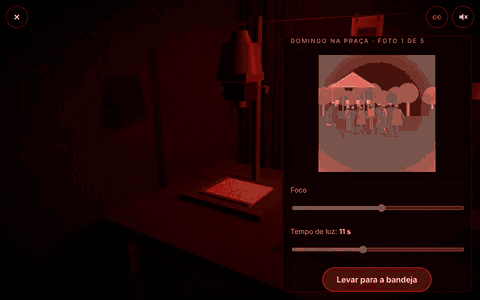
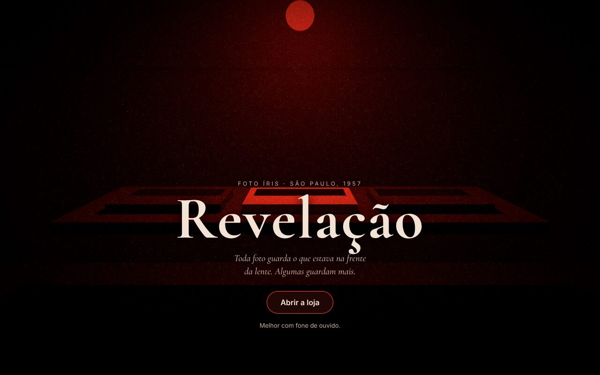
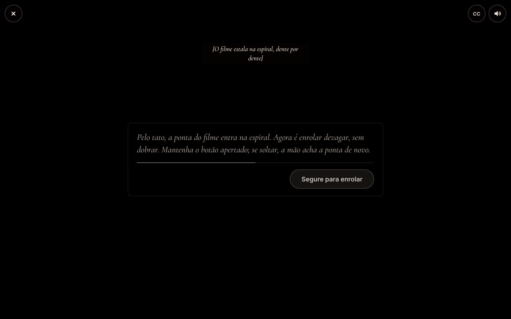
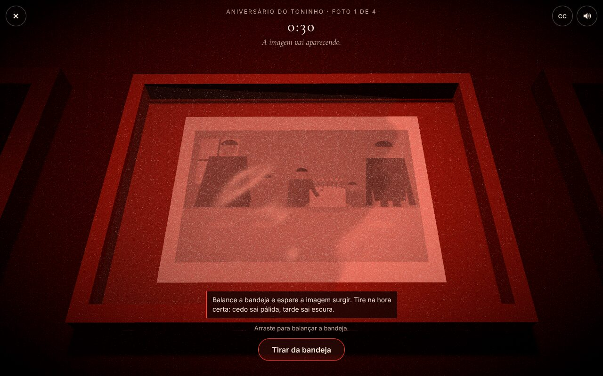
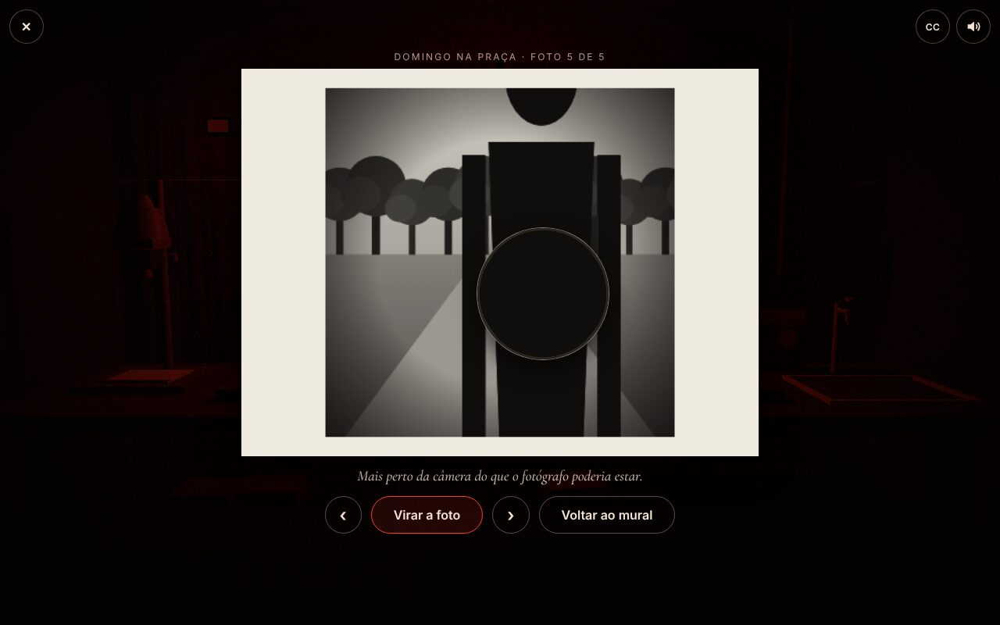
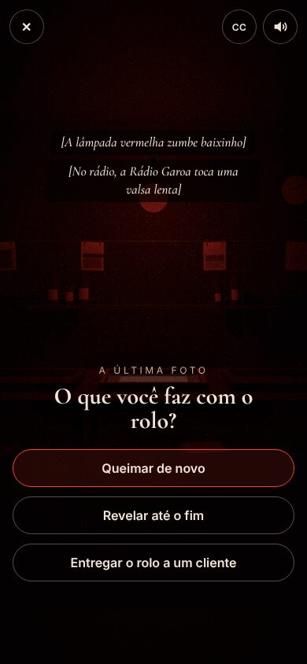

# Revelação

Um jogo de terror de tensão no navegador. Você é o revelador de fotos da Foto Íris, em São Paulo, 1957. Uma câmera quebrada chega à loja e, a partir dela, uma figura começa a aparecer nas suas fotos, cada vez mais perto.

Nada de susto com barulho alto. A criatura só existe nas fotografias: nunca aparece na sala, nunca se mexe na tela, só muda de uma foto para a outra. O medo vem de você mesmo balançar a bandeja e ver a imagem surgir.



## Como se joga

Dez dias na loja. Cada dia tem clientes no balcão, rolos de filme e as mesmas etapas de uma câmara escura de verdade:

1. **O tanque, no escuro total.** A luz apaga e a tela some. Pelo som e pelo tato, você abre o chassi e segura o botão para enrolar o filme na espiral.
2. **O ampliador.** Acerte o foco e escolha os segundos de luz. Mais luz, cópia mais escura.
3. **A bandeja.** Arraste (ou use as setas) para balançar o revelador. Tire na hora certa: cedo sai pálida, tarde sai escura. A figura revela por último.
4. **O varal e o mural.** Com a lupa, procure detalhes em cada foto. A partir do terceiro dia, a lupa acha outra coisa.

Três finais. E sempre dá para **ver as fotos sem revelar**, direto da tela de título.

| | |
| --- | --- |
|  |  |
|  |  |

<p align="center"></p>

## O que tem por baixo

- **Shader de revelação** (GLSL): a densidade de cada ponto do papel cresce com o tempo e com a agitação do líquido, acumulada numa textura float a cada quadro. Inclinar demais deixa uma ponta para trás. A camada da figura tem curva própria, mais lenta.
- **Sala 3D** com Three.js e React Three Fiber, iluminada só pela lâmpada de segurança, com bloom, grão e vinheta.
- **Som** com Tone.js: rádio de válvula tocando uma valsa (que desafina quando a figura surge na bandeja), goteira, zumbido da lâmpada, tudo posicionado em 3D (HRTF) e com legenda.
- **Roteiro como dado:** cada dia é um arquivo TypeScript puro em `web/src/game/days/`; a lógica que anda pelo roteiro não sabe nada de React nem de Three.js, e tem testes.
- **`revela`, uma CLI em Go** que confere e prepara as fotos (tons de cinza, negativo, WebP, `rolos.json`) com um pool de goroutines. Roda na CI: um PR com foto quebrada não passa.
- **Leve na primeira tela:** o título chega com ~105 kB (gzip); o Three.js baixa enquanto você lê, e o Tone.js só no clique.

## Acessibilidade

- Com `prefers-reduced-motion`, a lâmpada não pisca, a câmera não voa nem balança, o grão animado sai e o líquido não ondula. O jogo continua completo.
- Som só depois de um clique, com mudo e legendas sempre à vista. Todo som que importa para a história tem legenda.
- Tudo funciona com teclado, mouse ou toque, com alvos de 44 px no celular.
- Sem WebGL, o jogo segue sem a sala 3D, e o mural de fotos funciona.

## Rodar local

```bash
cd web
npm ci
npm run dev        # servidor local
npm test           # vitest
npm run build      # checagem de tipos + build

cd tools/revela
go test ./...
```

## Stack

- **Jogo:** React, TypeScript, Three.js (React Three Fiber), shaders GLSL, Zustand, Tone.js. Site estático na Vercel, sem backend.
- **Ferramenta das fotos:** CLI em Go.

Documentação: [história](docs/STORY.md), [arquitetura](docs/ARCHITECTURE.md), [roadmap](docs/ROADMAP.md), [decisões](docs/DECISIONS.md), [arte e som](docs/ART_AND_AUDIO.md). Para contribuir (pessoa ou IA), leia o [AGENTS.md](AGENTS.md).

Feito por [Victor Novakoski](https://github.com/Victor-Novakoski).
